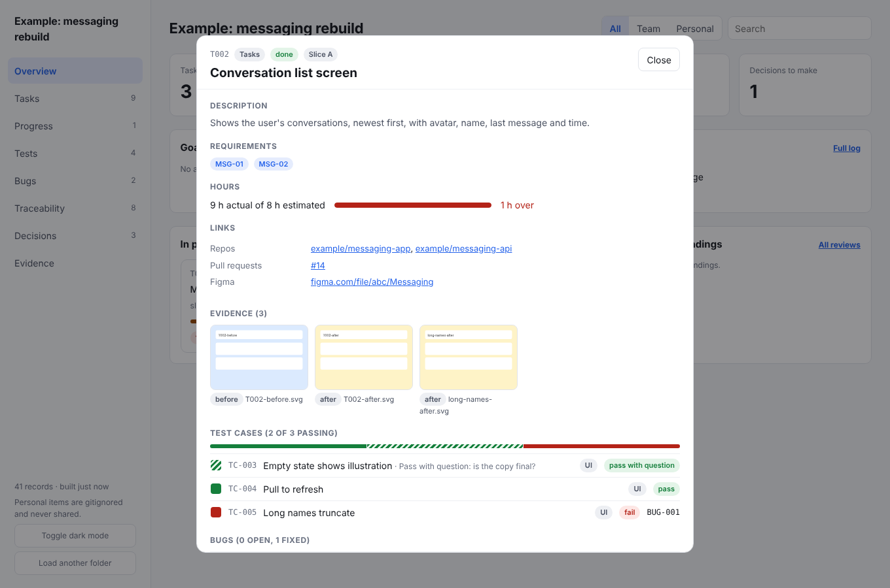
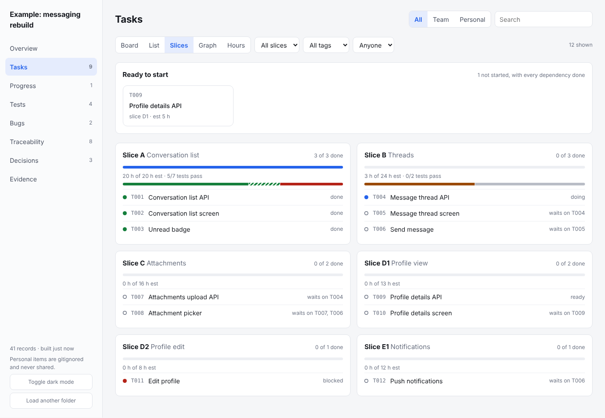
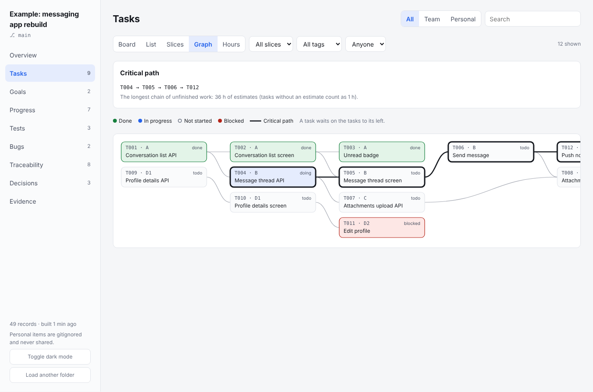
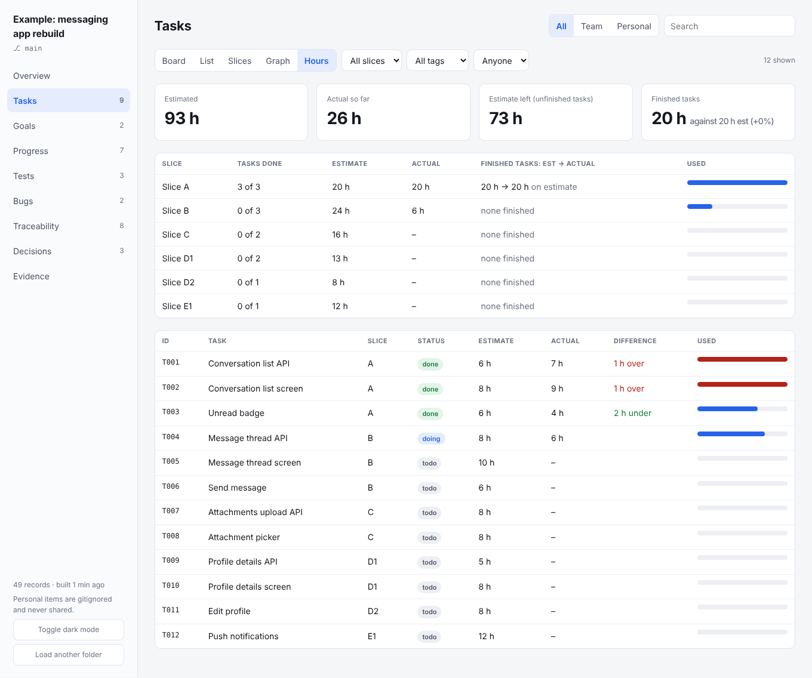
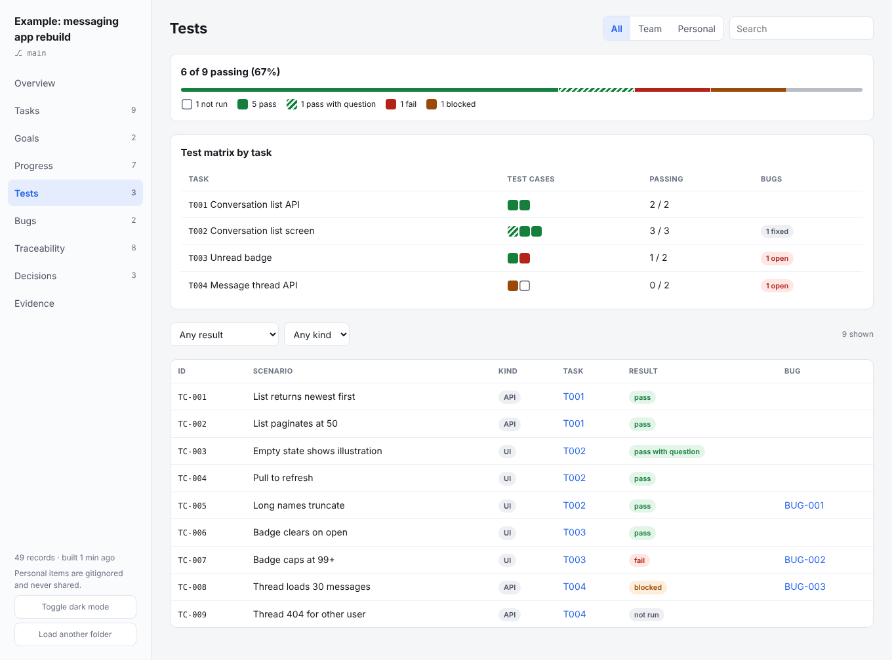
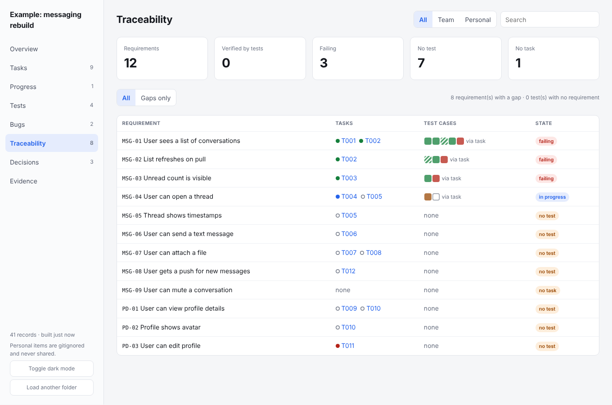
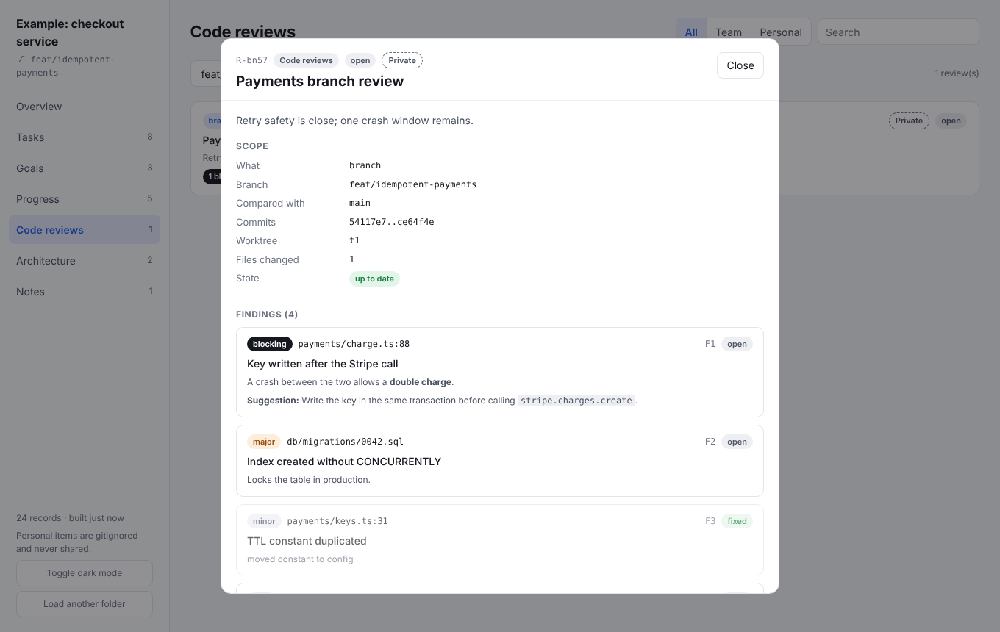
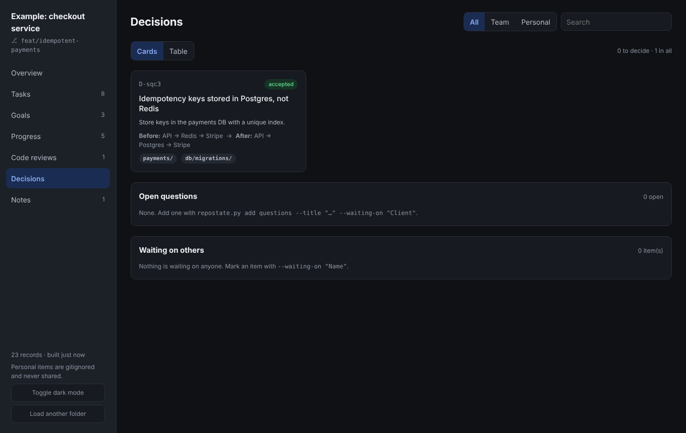

# repostate

[](https://github.com/Milan945/repostate/actions/workflows/ci.yml)
[](https://github.com/Milan945/repostate/releases)
[](LICENSE)
[](https://github.com/Milan945/repostate/stargazers)

**Your project's tasks, test cases, bugs, requirements and decisions, kept as JSON inside the repo, with a dashboard that opens from disk.**

repostate is an [Agent Skill](https://agentskills.io) for coding agents (Claude Code, Cursor, Codex and others). Instead of the agent rewriting `tasks.md` and `progress.md` by hand, it runs a small CLI that saves each item as JSON in your repo. A static HTML page shows everything: task board, slices, dependency graph, hours, test matrix, bugs, requirement traceability and screenshots. Team items are committed and shared through git. Personal items stay on your machine.

**[Open the live demo](https://milan945.github.io/repostate/)** · [Install](#install) · [What the dashboard shows](#what-the-dashboard-shows)


<sub>The demo uses the example project in [`examples/messaging-app`](examples/messaging-app): a hand-kept markdown hub file imported in one command. Build it yourself with `sh examples/messaging-app/build-demo.sh /tmp/demo`, then open `/tmp/demo/.repostate/index.html`.</sub>

## Why

- **Markdown plans drift.** Agents rewrite whole files, lose items, and break formatting. Here every change is one small, validated write.
- **QA lives next to the work.** Test cases, bugs and requirements link to tasks, so you can see what is tested, what failed and which requirements have no test.
- **You can see the state at a glance.** Board, slices, dependency graph, estimate against actual hours, test matrix, bugs, requirement traceability, screenshots, review findings and decisions.
- **It works for a team.** One JSON file per type, one record per line, random ids, and a merge helper that combines two branches record by record.
- **Nothing to host.** No server, no database, no account. Python 3.8+ and a browser.
- **No lock-in.** It's plain JSON in your repo, and `export` writes it back out as markdown.

## Install

**Claude Code** (plugin, recommended):

```
/plugin install repostate --marketplace Milan945/repostate
```

or `/plugin marketplace add Milan945/repostate` and then `/plugin install repostate@repostate`.

**Claude Code, Cursor, Codex and other Agent Skills tools** (copy the skills):

```bash
git clone https://github.com/Milan945/repostate && cd repostate
./install.sh                 # ~/.claude/skills (Claude Code, all projects)
./install.sh --project       # ./.claude/skills (this project only)
./install.sh --agents        # ~/.agents/skills
./install.sh --dir <path>    # your agent's skills folder
```

On Windows: `.\install.ps1` (same options: `-Project`, `-Dir <path>`).

## Use it

In any repo, ask your agent:

> Set up repostate in this repo and import our tasks.md.

The agent runs `init`, shows you a preview of what it found in your markdown files, and imports when you agree. Your original files are not changed. From then on, the agent adds tasks, starts and finishes them, and logs progress at the end of each session.

Things you can ask for:

| You say | What happens |
|---|---|
| "What's left on this project?" | Lists open tasks |
| "Add a task to cache tax lookups, high priority" | Creates a task |
| "Log what we did today" | Adds a progress entry and closes finished tasks |
| "Estimate T005 at 10 hours and put it in slice B" | Sets the estimate and slice |
| "What can I start now?" | Lists tasks whose dependencies are all done |
| "Record the test results for the list screen" | Saves test cases with pass, fail, blocked or not run |
| "TC-005 failed, log a bug" | Creates a bug linked to the task and the test case |
| "Which requirements have no test?" | Reads the traceability gaps |
| "Review this branch" | Saves a code review with findings, scoped to the branch |
| "We're moving webhooks to a worker, record that" | Saves an architecture decision with before and after |
| "Open the dashboard" | Builds and opens `.repostate/index.html` |

Or use the CLI yourself:

```bash
python3 .repostate/repostate.py add tasks --title "Cache tax lookups" --priority high
python3 .repostate/repostate.py list tasks --open
python3 .repostate/repostate.py done T-q57h
python3 .repostate/repostate.py log "Cached tax lookups per cart" --details "p95 down 40 ms"
python3 .repostate/repostate.py add tasks --id T037 --title "Mute a conversation" --slice D3 --estimate 6 --depends T005,T006
python3 .repostate/repostate.py hours T037 2.5 --note "API wiring"
python3 .repostate/repostate.py add testcases --id TC-014 --title "Badge caps at 99+" --task T003 --kind ui
python3 .repostate/repostate.py update TC-014 --result fail
python3 .repostate/repostate.py add bugs --title "Badge shows 100" --task T003 --severity medium --set testcase=TC-014
python3 .repostate/repostate.py open
```

Run `python3 .repostate/repostate.py --help` for every command.

## What's in the repo after setup

```
.repostate/
  team/tasks.json              one file per type, one record per line
  team/testcases.json          committed: everyone with the repo sees it
  team/bugs.json  …
  personal/<type>.json         gitignored: only you, on this machine
  config.json                  team settings (statuses, fields, custom types)
  config.local.json            your own overrides (gitignored)
  index.html                   the dashboard
  data.js                      generated for the dashboard (gitignored)
  repostate.py                 the CLI, so teammates can use it without installing anything
```


## What the dashboard shows

**Task detail.** Click any task to see its description, requirements, repos, pull requests, estimate and actual hours, Figma links, screenshots, test cases, bugs and a timeline of status changes and log entries.



**Slices and "ready to start".** Tasks grouped by slice (A, B, C, D1 …) with a progress bar, hours and test results for each, and a list of tasks that are not started and have every dependency done.



**Dependency graph.** Tasks drawn left to right by what they wait on, coloured by status, with the critical path (the longest chain of unfinished work, weighted by estimates) marked.



**Estimate and actual.** Hours per task and per slice, and how finished work compared with its estimate.



**Test matrix and bugs.** Every test case as a coloured square per task, the overall pass rate, and open and fixed bug counts per task. Task cards on the board carry a pass-rate bar and a bug count.



**Requirements traceability.** Requirement → tasks → test cases, with each requirement marked verified, failing, in progress, no test or no task. Tests and tasks with no requirement are listed too.



**Evidence.** Images in `screenshots/` and `ui-review/` are attached to the record whose id is in the file or folder name (`screenshots/T002-before.png`), and shown as thumbnails on the task and on an Evidence page. Clicking one opens a viewer on the page, where you can step through the before and after shots with the arrow keys.

**Decisions and open questions.** Decisions with owner and status, open questions, and everything that is waiting on someone else, grouped by who.

Pages appear only when there is data for them, so a small repo that only tracks tasks stays simple.

## The four skills

| Skill | Use it for |
|---|---|
| `repostate` | Tasks (slices, dependencies, estimates, hours, links), goals, progress log, open questions, notes, importing markdown, the dashboard |
| `repostate-qa` | Test cases and results, bugs linked to tasks and tests, requirement traceability, screenshot evidence |
| `repostate-review` | Code reviews scoped to a **branch**, **worktree**, **agent session**, **commit range** or **uncommitted changes**. Each finding has a severity, file and line. The dashboard flags a review as outdated when its branch gets new commits. |
| `repostate-architecture` | Decision records: context, decision, consequences, alternatives, before and after, owner, affected components and linked tasks |



## Team and personal

| | Team | Personal |
|---|---|---|
| Stored in | `.repostate/team/` (committed) | `.repostate/personal/` (gitignored) |
| Who sees it | Everyone with access to the repo | Only you |
| Default for | Tasks, goals, progress, decisions, questions, test cases, bugs, requirements | Code reviews, notes |

- Move items with `promote <id>` (personal → team) and `unshare <id>` (team → personal).
- The dashboard has an **All / Team / Personal** switch, and personal items carry a "Private" badge.
- Access to team data is exactly access to the repo. A private repo keeps its data private.

**For teammates:** after cloning, run `python3 .repostate/repostate.py hooks` once, then open `.repostate/index.html`. `hooks` rebuilds the dashboard after every pull and makes git merge the JSON files record by record. Without it, two branches that both add records to the same file can hit an ordinary merge conflict. The page also has a "Choose the .repostate folder" button that works without any build step.

**On pull requests:** `init --actions` adds a GitHub Action that posts one comment per pull request with task counts, goal progress, and the records the branch added or changed.

## Import from markdown

```bash
python3 .repostate/repostate.py import tasks.md progress.md goals.md docs/adr/*.md --dry-run
```

Understands checkbox lists, status headings ("In progress", "Done", "Blocked"), nested subtasks, `#tags`, `@assignees`, `P0`–`P3` or `!high` priorities, `due: 2026-12-05`, dated progress headings and ADR files. Re-running skips items already imported.

It also reads **markdown tables**, so a hand-kept hub file imports in one go:

```markdown
## Tasks
| ID   | Task               | Slice | Status      | Depends on | Est dev h | Actual h | Requirements |
|------|--------------------|-------|-------------|------------|-----------|----------|--------------|
| T001 | Conversation list  | A     | ✅ Done     | —          | 6         | 7        | MSG-01       |
| T004 | Message thread API | B     | In progress | T001       | 8         | 3        | MSG-04       |

## Test cases
| TC     | Scenario            | Task | Kind | Result | Bug     |
|--------|---------------------|------|------|--------|---------|
| TC-005 | Long names truncate | T002 | UI   | Fail   | BUG-001 |

## Defects
| ID      | Defect              | Severity | Status | Task | Test case | Fix commit |
```

Tables of tasks, test cases, defects, decisions, open questions and requirements are recognised from their columns or the heading above them. Ids in the table are kept. While the markdown file is still where you edit, `import --update` refreshes the records from changed rows. Details: [skills/repostate/references/import.md](skills/repostate/references/import.md).

## Customize

Edit `.repostate/config.json`:

```json
{
  "project": { "name": "Checkout API", "accent": "#0F766E" },
  "types": {
    "tasks": {
      "statuses": ["backlog", "todo", "doing", "review", "done"],
      "fields": { "estimate_hours": { "type": "number" }, "client": { "type": "string" } }
    },
    "testcases": { "statuses": ["not_run", "pass", "pass_with_question", "fail", "blocked", "skipped"] },
    "meetings": { "prefix": "M", "label": "Meetings", "view": "timeline", "statuses": [] }
  },
  "hidden": ["notes"]
}
```

`tasks`, `goals`, `progress`, `decisions`, `questions`, `testcases`, `bugs`, `requirements`, `reviews` and `notes` are built in and can all be reshaped this way. A new type of your own (say `meetings`) gets its own page in the dashboard. You can also name slices (`"slices": {"A": "Conversation list"}`), change the screenshot folders (`"evidence": {"dirs": [...]}`), and switch a type to generated `T001, T002 …` ids (`"ids": "sequential"`). All options: [skills/repostate/references/customize.md](skills/repostate/references/customize.md). Record shapes: [skills/repostate/references/schema.md](skills/repostate/references/schema.md).



## Design choices

This repo tracks itself with repostate: see [`.repostate/team/decisions.json`](.repostate/team/decisions.json) for why it uses one file per type, JSON instead of SQLite, a team/personal split, and a generated `data.js`.

## Contributing

```bash
python3 -m unittest discover -s tests -v
```

To release, bump `version` in `.claude-plugin/plugin.json`, add a section to `CHANGELOG.md`, and merge to `main`: a workflow tags the commit and publishes the release.

`skills/repostate/scripts/repostate.py` and `skills/repostate/assets/index.html` are the sources. After changing them, run `python3 skills/repostate/scripts/repostate.py init` at the repo root to refresh the copies in `.repostate/`. CI checks that they match.

## License

MIT
