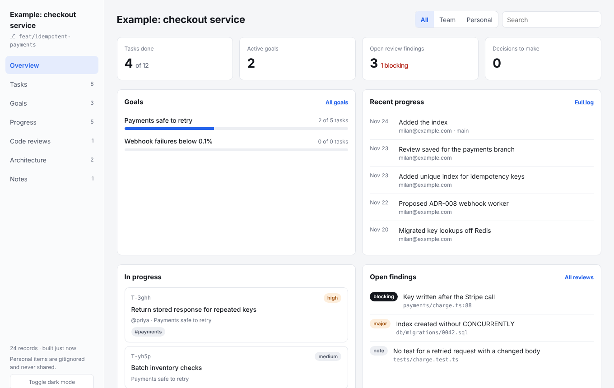
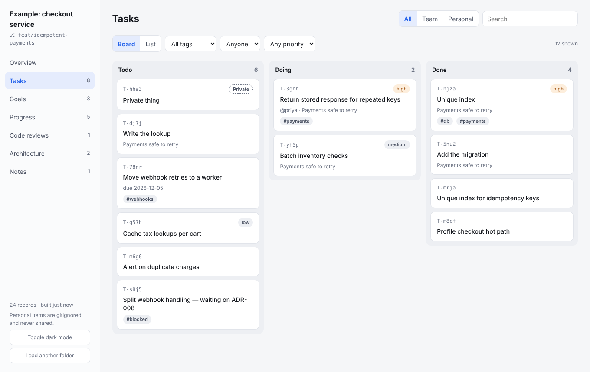

# repostate

**Your project's tasks, goals, progress, code reviews and architecture decisions, kept as JSON inside the repo, with a dashboard that opens from disk.**

repostate is an [Agent Skill](https://agentskills.io) for coding agents (Claude Code, Cursor, Codex and others). Instead of the agent rewriting `tasks.md` and `progress.md` by hand, it runs a small CLI that saves each item as a JSON file. A static HTML page shows everything. Team items are committed and shared through git. Personal items stay on your machine.



<sub>Screenshots use example data.</sub>

## Why

- **Markdown plans drift.** Agents rewrite whole files, lose items, and break formatting. Here every change is one small, validated write.
- **You can see the state at a glance.** Board, goal progress, a progress timeline, review findings and architecture decisions on one page.
- **It works for a team.** One file per record and random ids mean two people on two branches don't get merge conflicts.
- **Nothing to host.** No server, no database, no account. Python 3.8+ and a browser.
- **No lock-in.** It's plain JSON in your repo, and `export` writes it back out as markdown.

## Install

**Claude Code** (plugin, recommended):

```
/plugin install repostate --marketplace Milan945/repostate
```

or `/plugin marketplace add Milan945/repostate` and then `/plugin install repostate@repostate`.

**Claude Code, Cursor, Codex and other Agent Skills tools** (copy the skills):

```bash
git clone https://github.com/Milan945/repostate && cd repostate
./install.sh                 # ~/.claude/skills (Claude Code, all projects)
./install.sh --project       # ./.claude/skills (this project only)
./install.sh --agents        # ~/.agents/skills
./install.sh --dir <path>    # your agent's skills folder
```

On Windows: `.\install.ps1` (same options: `-Project`, `-Dir <path>`).

## Use it

In any repo, ask your agent:

> Set up repostate in this repo and import our tasks.md.

The agent runs `init`, shows you a preview of what it found in your markdown files, and imports when you agree. Your original files are not changed. From then on, the agent adds tasks, starts and finishes them, and logs progress at the end of each session.

Things you can ask for:

| You say | What happens |
|---|---|
| "What's left on this project?" | Lists open tasks |
| "Add a task to cache tax lookups, high priority" | Creates a task |
| "Log what we did today" | Adds a progress entry and closes finished tasks |
| "Review this branch" | Saves a code review with findings, scoped to the branch |
| "We're moving webhooks to a worker, record that" | Saves an architecture decision with before and after |
| "Open the dashboard" | Builds and opens `.repostate/index.html` |

Or use the CLI yourself:

```bash
python3 .repostate/repostate.py add tasks --title "Cache tax lookups" --priority high
python3 .repostate/repostate.py list tasks --open
python3 .repostate/repostate.py done T-q57h
python3 .repostate/repostate.py log "Cached tax lookups per cart" --details "p95 down 40 ms"
python3 .repostate/repostate.py open
```

Run `python3 .repostate/repostate.py --help` for every command.

## What's in the repo after setup

```
.repostate/
  team/<type>/<id>.json        committed: everyone with the repo sees it
  personal/<type>/<id>.json    gitignored: only you, on this machine
  config.json                  team settings (statuses, fields, custom types)
  config.local.json            your own overrides (gitignored)
  index.html                   the dashboard
  data.js                      generated for the dashboard (gitignored)
  repostate.py                 the CLI, so teammates can use it without installing anything
```



## The three skills

| Skill | Use it for |
|---|---|
| `repostate` | Tasks, goals, progress log, notes, importing markdown, the dashboard |
| `repostate-review` | Code reviews scoped to a **branch**, **worktree**, **agent session**, **commit range** or **uncommitted changes**. Each finding has a severity, file and line. The dashboard flags a review as outdated when its branch gets new commits. |
| `repostate-architecture` | Architecture decision records: context, decision, consequences, alternatives, before and after, affected components and linked tasks |


## Team and personal

| | Team | Personal |
|---|---|---|
| Stored in | `.repostate/team/` (committed) | `.repostate/personal/` (gitignored) |
| Who sees it | Everyone with access to the repo | Only you |
| Default for | Tasks, goals, progress, decisions | Code reviews, notes |

- Move items with `promote <id>` (personal → team) and `unshare <id>` (team → personal).
- The dashboard has an **All / Team / Personal** switch, and personal items carry a "Private" badge.
- Access to team data is exactly access to the repo. A private repo keeps its data private.

**For teammates:** after cloning, run `python3 .repostate/repostate.py build` once, or `hooks` to rebuild automatically after every pull, then open `.repostate/index.html`. The page also has a "Choose the .repostate folder" button that works without any build step.

**On pull requests:** `init --actions` adds a GitHub Action that posts one comment per pull request with task counts, goal progress, and the records the branch added or changed.

## Import from markdown

```bash
python3 .repostate/repostate.py import tasks.md progress.md goals.md docs/adr/*.md --dry-run
```

Understands checkbox lists, status headings ("In progress", "Done", "Blocked"), nested subtasks, `#tags`, `@assignees`, `P0`–`P3` or `!high` priorities, `due: 2026-12-05`, dated progress headings and ADR files. Re-running skips items already imported. Details: [skills/repostate/references/import.md](skills/repostate/references/import.md).

## Customize

Edit `.repostate/config.json`:

```json
{
  "project": { "name": "Checkout API", "accent": "#0F766E" },
  "types": {
    "tasks": {
      "statuses": ["backlog", "todo", "doing", "review", "done"],
      "fields": { "estimate_hours": { "type": "number" }, "client": { "type": "string" } }
    },
    "bugs": {
      "prefix": "B", "label": "Bugs", "view": "board",
      "statuses": ["new", "fixing", "fixed"],
      "fields": { "severity": { "type": "enum", "options": ["low", "high"], "required": true } }
    }
  },
  "hidden": ["notes"]
}
```

New types like `bugs` get their own page in the dashboard. All options: [skills/repostate/references/customize.md](skills/repostate/references/customize.md). Record shapes: [skills/repostate/references/schema.md](skills/repostate/references/schema.md).


## Design choices

This repo tracks itself with repostate: see [`.repostate/team/decisions/`](.repostate/team/decisions/) for why it uses one file per record, JSON instead of SQLite, a team/personal split, and a generated `data.js`.

## Contributing

```bash
python3 -m unittest discover -s tests -v
```

`skills/repostate/scripts/repostate.py` and `skills/repostate/assets/index.html` are the sources. After changing them, run `python3 skills/repostate/scripts/repostate.py init` at the repo root to refresh the copies in `.repostate/`. CI checks that they match.

## License

MIT
